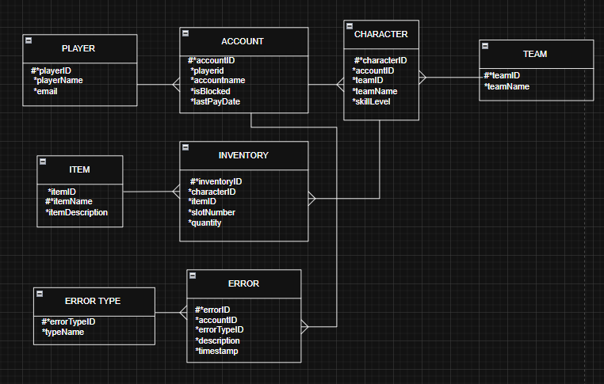

# MMORPG Account Management Database

A relational database design for a Massively Multiplayer Online Role-Playing Game (MMORPG). It manages players, their accounts, characters, teams, in-game items, inventories and error logs. The design was normalised from raw data to Third Normal Form (3NF) to reduce redundancy and keep the data consistent.

This was a school project for the **Database Design Concepts** module (Information Technology, Eduvos Durban, June 2025).

## Entity-Relationship Diagram (3NF)



## Entities

| Table | Purpose |
| --- | --- |
| `Player` | Registered users of the game |
| `Account` | Game accounts, with blocked status and last payment date |
| `Character` | Avatars controlled by a player's account |
| `Team` | Groups that characters belong to |
| `Item` | Objects that can be collected in the game |
| `Inventory` | Item slots held by each character |
| `ErrorType` | Categories of errors (for example, syntax or runtime errors) |
| `Error` | Individual error events with a timestamp |

## Relationships

| Relationship | Type |
| --- | --- |
| Player to Account | One-to-many |
| Account to Character | One-to-many |
| Character to Inventory | One-to-many |
| Inventory to Item | Many-to-one |
| Character to Team | Many-to-one |
| Account to Error | One-to-many |
| Error to ErrorType | Many-to-one |

## Business rules

- A player can have more than one account.
- Each account can create multiple characters.
- Characters can be grouped into teams.
- Each character has up to 8 inventory slots.
- Errors must be logged with a timestamp and an error type.
- Duplicate items are allowed and tracked through a quantity.

## Normalisation process

The design was taken through each stage, and the diagrams are in [`docs/normalization`](docs/normalization):

1. Raw data collection
2. **0NF:** unstructured data with repeating groups
3. **1NF:** atomic values, with characters, items and errors separated out
4. **2NF:** partial dependencies removed
5. **3NF:** transitive dependencies removed, such as team name on Character, by creating the `Team` and `ErrorType` tables

## Repository contents

| File | Description |
| --- | --- |
| `schema.sql` | `CREATE TABLE` statements with primary keys, foreign keys and constraints |
| `sample_data.sql` | Sample records from the project report |
| `queries.sql` | Example queries using joins, grouping and sorting |
| `docs/erd.png` | Entity-relationship diagram |
| `docs/normalization/` | Diagrams for each normalisation stage |
| `docs/report/` | Full project report (Word document) |

## How to run it

Any SQL database will work. The steps below use SQLite, which needs no setup:

```bash
sqlite3 mmorpg.db < schema.sql
sqlite3 mmorpg.db < sample_data.sql
sqlite3 -header -column mmorpg.db < queries.sql
```

You can also paste the contents of the files into an online SQL tool such as [SQLite Online](https://sqliteonline.com/). Run `schema.sql` first, then `sample_data.sql`, then `queries.sql`.

## Tools used

- SQL (SQLite)
- Draw.io for the diagrams

## Author

Khulani Ngubane, Durban, South Africa
GitHub: [@khulaningub](https://github.com/khulaningub)
